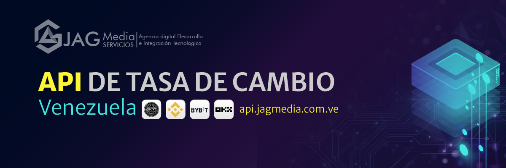
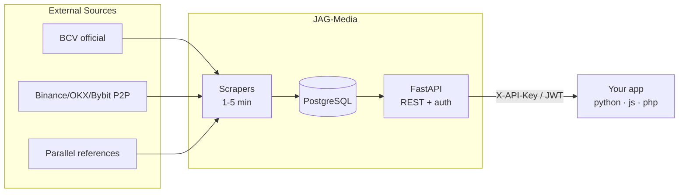

<p align="center">
  
</p>

<h1 align="center">Consumption Examples</h1>

<p align="center">
  <a href="LICENSE"></a>
  <a href="https://api.jagmedia.com.ve/v1/estado"></a>
  <a href="https://jagmedia.com.ve/api-docs.php"></a>
  <a href="README.es.md"></a>
</p>

Official integration examples for the Venezuelan exchange rates API.

**Base URL:** `https://api.jagmedia.com.ve`
**Docs:** https://jagmedia.com.ve/api-docs.php
**Sign up:** https://jagmedia.com.ve/registro.php

## What it is — and is NOT

| Is | Is NOT |
|----|--------|
| Consolidated exchange-rate data API | An exchange — you can't buy/sell currency |
| BCV official + P2P references + parallel | A mobile app — it's an API for systems |
| Public anti-spoofing methodology | A guaranteed SLA — honest about what it delivers |
| C2P BDV payments in VES | USD payments today (PayPal disabled) |

## Quickstart — 30 seconds

```bash
pip install requests
export JAGMEDIA_API_KEY="jmg_your_api_key"   # from jagmedia.com.ve/cuenta.php
python python/tasas.py
```

## Architecture



## Authentication

| Method | Header | Best for |
|--------|--------|----------|
| API Key | `X-API-Key: jmg_your_api_key` | scripts, backends |
| JWT | `Authorization: Bearer <token>` | session-based apps |

## Main endpoints

| Endpoint | Auth | Description |
|----------|------|-------------|
| `GET /v1/tasas` | yes | Consolidated rates: BCV + P2P + parallel |
| `GET /v1/convertir` | yes | Convert amounts between currencies |
| `GET /v1/spread` | yes | BCV vs market spread |
| `GET /v1/historico/{currency}` | yes* | History (Starter 7d · Dev/Ent 365d) |
| `GET /v1/estado` | no | Data-source health |
| `GET /bancos` | yes | Venezuelan bank rates |

## Examples by language

- [Python](python/tasas.py) — `requests`
- [JavaScript](javascript/tasas.js) — `fetch` (Node 18+)
- [PHP](php/tasas.php) — `cURL`
- [cURL](curl/ejemplos.sh) — terminal
- [Webhooks](webhooks/receptor.py) — HMAC signature verification (`X-Signature-256`)
- [Postman](postman/JAG-Media-Tasas.postman_collection.json) — importable collection
- [Samples](samples/) — real API responses, no signup needed
- [Errors](ERRORS.md) — documented 401/403/422/429/503 responses

## Typical response `GET /v1/tasas`

```json
{
  "pais": "VE",
  "base": "USD",
  "bcv": {
    "USD": { "venta": 889.2553, "compra": 889.2553, "promedio": 889.2553, "fuente": "BCV" },
    "EUR": { "venta": 982.7589, "promedio": 982.7589 }
  },
  "p2p": { "binance_ves": 998.5 },
  "paralelo": 1008.49
}
```

---

*Documentación en español:* [README.es.md](README.es.md)
